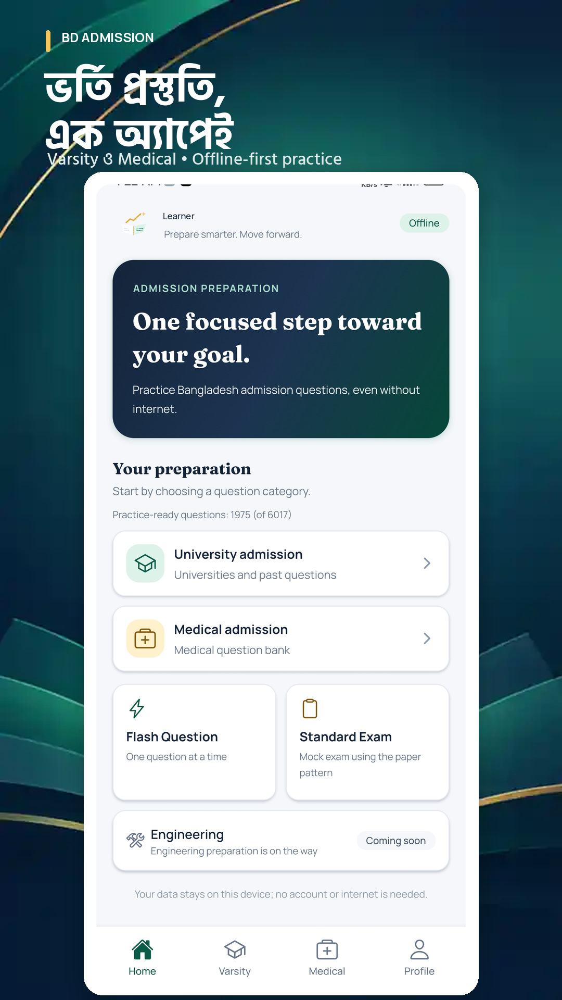
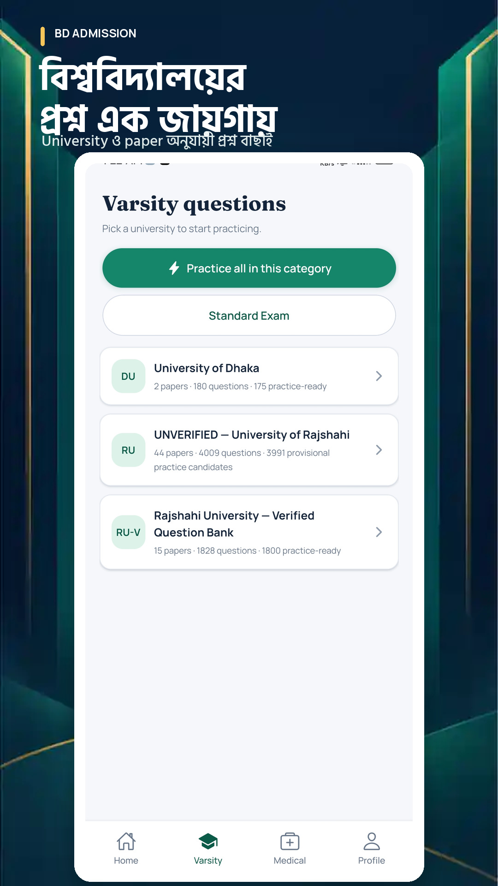
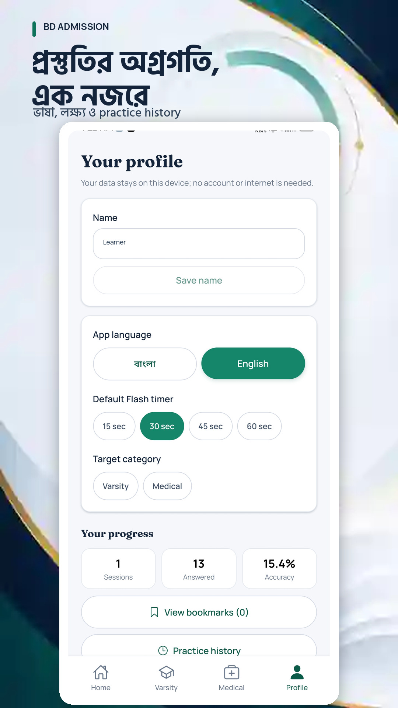

# BD Admission

A Bangladesh-focused, offline-first Android admission-preparation app for university (Varsity) and Medical admission questions. The app supports Bangla and English, question browsing, Flash Question practice, Standard Exam sessions, bookmarks, a local profile, and practice history. Engineering is visible as Coming Soon.

## App preview

  
  
  

Play Store-inspired README artwork built around actual runtime captures; this three-screen set is not a final Play Console asset pack. The profile display name is anonymized, and visible counters are sample local data rather than product-wide usage metrics.

## Current implementation status

**Latest Android preview build:** version 0.1.5 (Android versionCode 6), EAS internal APK build is IN_PROGRESS. [EAS preview build 41bd1c7e-9376-41a7-abb0-860ab8031273](https://expo.dev/accounts/sk_king13/projects/bd-admission-app/builds/41bd1c7e-9376-41a7-abb0-860ab8031273). No new APK artifact is available until the build finishes; the previous completed installable APK remains v0.1.4 / code 5.

The core app implementation is wired across the Expo Router screens, SQLite database lifecycle, repositories, practice services, question-pack importer, and local user data. The 2026-11-05 correctness pass adds read-back-verified profile-name persistence, safe display-only math notation, a read-only question-quality audit and partial official-rule support without invented score components. Exact paper practice no longer silently inherits the global 100/60 format. See [current state](docs/CURRENT_STATE.md), [official exam-rule research](docs/EXAM_RULE_RESEARCH.md), and [question-quality audit](docs/QUESTION_QUALITY_AUDIT.md).

**Startup setup experience:** the branded Bangla/English setup screen explains database preparation and question-library synchronization and shows processed-pack progress. v0.1.4 fixes the SQLite sidecar destination URI mismatch found after v0.1.3 failed during the first question-library import. The new APK is built, its embedded seed is integrity-verified, and the owner has confirmed the phone verification is successful. A very subtle square flash during the loading-to-home transition remains a non-blocking UI-polish note.

**Previous Android preview (historical GitHub release):** BD Admission `0.1.0` is available as the public GitHub pre-release [`v0.1.0-preview.1`](https://github.com/itssourov13/bd-admission-app/releases/tag/v0.1.0-preview.1), published on **31 October 2026 (Bangladesh time)**. Download [`BD.Admission.v0.1.0.apk`](https://github.com/itssourov13/bd-admission-app/releases/download/v0.1.0-preview.1/BD.Admission.v0.1.0.apk). The APK was installed and checked on a physical Android device; the owner reported normal operation. This is an Android preview/pre-release, **not** a Google Play production release.

Two DU A Unit packs are bundled from the supplied scanned question-bank PDFs: 90 questions per session for 2024–2025 and 2025–2026, across six subject sections. The supplied answer-key letters are preserved; three questions without a printed key remain unanswered/unknown rather than guessed. The supplied publisher scan is a question-bank source, not an official DU past-paper notice. The official DU 2025–2026 notice describes 60 marks of MCQ plus 40 marks of written questions, with 45 minutes for each part ([official notice](https://www.du.ac.bd/du_post_details/news/25400)); its complete format differs from the scan’s four-of-six-subject MCQ-only practice pattern. That rule therefore remains **illustrative** and the app labels the selected-paper mode as question-bank practice, not a full official DU exam. Question-level local PNG figures are supported by the runtime. Two items are content-unverified and excluded from scored practice: one figure-only physics item and one mathematics formula whose scanned expression is unclear.

The first EAS preview APK build completed and was published as the GitHub pre-release above. The owner has confirmed physical-device installation and verification. GitHub PR #2 was merged and both the pull-request CI run and the resulting `main` push CI run succeeded. The standard local Hermes bytecode export still raises SIGILL on this ARM/NetHunter host; this host-specific issue did not block the EAS cloud APK build. A production AAB, Play Console listing and production rollout remain outstanding.

## HSTU verified-question import — 2026-11-12

Claude's accepted HSTU verification ledger was imported as the source of truth: **664 questions** now have both existing verification fields set to verified in the normal HSTU catalogue. Of these, 657 moved from HSTU-U paper appearances into 15 HSTU papers, and 7 were already in HSTU and received their accepted answer mappings. HSTU now contains **22 papers / 950 questions**, including **939 fully verified single-choice questions** in the normal practice pool. The **116 baseline pending** questions were left untouched; HSTU-U retains **105 pending questions** (102 answer-unverified, 3 answer-unknown). Question IDs, stems, option order/text and source references were preserved. The app bundle remains 217 packs / 13,609 questions. See the HSTU import workflow (docs/QUESTION_IMPORT_WORKFLOW.md) for source, backup and validation details. This data update has not yet shipped in a new APK.

## RU question bank sections — separate by source/status

The Varsity catalogue keeps two separate Rajshahi University entries:

- **`RU-V — Rajshahi University — Verified Question Bank`** is the user-confirmed verified source import from `RU Question Bank.pdf`. The previous 15-pack/1,815-question version was replaced by **15 packs / 1,828 questions** covering sessions 2016–2017 through 2024–2025 (units A, C, D1, F and H as represented in the PDF). Every imported question has `contentVerificationStatus: verified` and `answerVerificationStatus: verified`, with four non-empty options. This includes 1,800 single-choice questions, 22 source `X` records retained as `no_correct_option`, and 6 multi-answer records retained as `multiple_choice`. All have subject metadata for Physics, Chemistry, Biology, Higher Mathematics, ICT or English. No imported RU-V question is tagged `unverified` or `unknown`.
- **`RU — UNVERIFIED — University of Rajshahi`** remains the separate 44-pack, 4,009-question RU C Unit candidate bank imported earlier from third-party source pages. Its question/answer statuses, assets and provisional-practice rules were not altered by the RU-V replacement.

The RU Question Bank PDF has 156 pages and SHA-256 `f1fc25faef0bba80d4495002f3006ac4ca1a7ce9da5c26e6a1f7db45218a49c7`. The user confirmed this source/question content as verified; the replacement task repaired extraction structure and imported the source, without repeating question-by-question fact checking. A total of **154** source records remain in the external exclusion ledger: 36 written-part items, 90 with incomplete option count/labels, 26 with missing extracted option text and 2 without an extracted answer marker. The 22 `X` and 6 complete multiple-answer records are included rather than discarded. A white Sutonny text-shadow on page 137 was filtered as a false banner and the printed B answer for Mathematics Q4 was recovered. No answer or option text was fabricated. Thirty included questions with repeated extracted option text are listed in the separate external warning audit. Pack/source/exclusion/reconciliation artifacts are outside the repo under `/home/kali/gpt-workspace/bd-admission-app-data/ruv-work/`.

The bundled catalogue contains 217 JSON packs / 13,609 questions across DU, RU, RU-V, verified JU/HSTU and separate JU-U/HSTU candidate banks. The previous completed preview is v0.1.4 / Android versionCode 5; its [installable APK remains available here](https://expo.dev/artifacts/eas/ePmli5F3NH4vc9q1RupboKmJbt2FxkI8YdjbMW54-Jo.apk). The next candidate is v0.1.5 / code 6. It keeps canonical question JSON in Git and regenerates the SQLite seed during CI/EAS builds. v0.1.3 failed during first question-library import on the owner's phone; the owner has since installed and verified v0.1.4 successfully. The production AAB and Google Play rollout remain pending.

## JU-U + HSTU-U unverified candidate banks — initial import 2026-11-01 (HSTU counts superseded)

These are separate catalogue entries, not replacements or additions to the verified `JU` and `HSTU` institutions above:

- **`JU-U — UNVERIFIED — Jahangirnagar University`:** 84 packs / 5,011 questions, with sessions represented from 2010–2011 through 2024–2025. All question content is `unverified`; answer states are 4,820 `unverified` and 191 `unknown`. A provisional pool exposes 4,780 structurally safe candidates; 28 single-key records with repeated normalized option text are browse-only. Twelve questions have exact text-and-ordered-option overlaps with existing packs, and 95 more share a normalized stem but differ in option text/order. They remain separate source records and were not auto-merged.
- **`HSTU-U — UNVERIFIED — Hajee Mohammad Danesh Science and Technology University`:** initially 15 packs / 762 questions across sessions 2014–2015 through 2024–2025. After the 2026-11-12 promotion, **105 pending questions** remain across those 15 paper entries: 102 answer-unverified and 3 answer-unknown; content remains unverified. The original 722-candidate provisional count is a historical pre-promotion figure, not the current HSTU-U total.
- At the initial 2026-11-01 candidate-bank import, 19 multiple-choice records were present across JU-U/HSTU-U. The HSTU 2026-11-12 promotion applied Claude’s accepted answers, leaving 6 HSTU-U multiple-choice items among the pending records. The 99 original candidate-bank rules remain unconfigured; the 15 added HSTU paper rules are also unconfigured. Provisional feedback on remaining candidate records uses unverified source keys and is not a verified or official score.
- JU-U remains separate from verified JU. HSTU pending candidates remain under the HSTU-U institution; the 664 accepted HSTU verified IDs now use the normal HSTU institution through dedicated paper appearances. Stable question/batch identities and source provenance are retained.
- The three separate `GST_CLUSTER` packs (287 questions) were **not imported**; GST content will be handled in a dedicated follow-up. HSTU-specific papers remain classified as HSTU even where the source compilation title mentions a GST question bank.
- The current published preview APK predates this addition; a new build/install is required for these candidate banks to appear on a device.

## Jahangirnagar + HSTU verified-source question banks — initial import 2026-11-01 (HSTU updated 2026-11-12)

- **Jahangirnagar University:** 50 packs / 1,526 questions, covering sessions 2010–2011 through 2024–2025 across 31 represented session/unit combinations. The coverage is a 15-session span, not a claim that every unit/set is complete in every year.
- **Hajee Mohammad Danesh Science and Technology University (HSTU):** the initial verified-source import supplied 7 papers / 293 questions across 2016–2017, 2017–2018 and 2024–2025. The 2026-11-12 promotion added 657 accepted verified questions across 15 paper appearances, bringing the normal HSTU catalogue to 22 papers / 950 questions. This remains a partial historical collection, not the requested 15–20-year HSTU bank.
- The original Muse-source question content is marked content-verified. JU answer states remain unchanged: 1,414 verified, 111 unverified and 1 unknown. For HSTU, the later accepted Claude verification ledger added/updated 664 IDs; the current normal HSTU catalogue has 939 verified, 1 unverified and 10 unknown answer states. Both status fields are verified for the 664 ledger IDs imported on 2026-11-12.
- **2,332 questions** are currently eligible for verified single-choice practice across JU and HSTU (JU 1,393; HSTU 939). Six JU records retain `multiple_choice` type and 16 retain an explicit `no_correct_option` source marker; neither is forced into the single-choice engine. Six questions have identical option text in at least two choices; those source values were retained as received.
- Of the 57 verified-source JU/HSTU exam-rule records, 8 now contain only partial, source-backed 2024–2025 facts (3 JU and 5 HSTU); 49 remain `unconfigured`. Partial rules never imply complete numerical scoring. Exact-paper Standard Exam uses only a usable rule for that paper; the 100-question/60-minute default applies only to general all-catalogue practice. No paper is padded or merged to satisfy a required quota. See [the research record](docs/EXAM_RULE_RESEARCH.md).
- The source archive was `/home/kali/gpt-workspace/museai/admission-app-research/import-ready/Admission_Import_Ready_Questions_Only.zip` (SHA-256 `cd3f0b449ae9cb18a254197dfe557198e2039ab74d4e0ff64e2abf69cd972f1b`). One source-document ID was shared across 24 JU packs; it was namespaced by batch and all local references updated. Question text, options, answer keys, per-question verification states and source metadata were otherwise preserved. See `docs/QUESTION_IMPORT_WORKFLOW.md` for the full import record.

## Main features

- **Offline-first data:** SQLite is the local source of truth for question content, paper/source references, exam attempts, answers, bookmarks, profile preferences and activity history.
- **Varsity and Medical catalogues:** institution/paper selection is driven by imported data; the question browser paginates results, filters by subject, shows per-subject counts and bookmarks, and orders subject groups canonically.
- **Flash Question:** subject-filterable practice setup, one question at a time, 30-second default with configurable duration, deadline-based timing, no repeats until a pool cycle is exhausted, skip/exit, answer feedback, summaries and persistent history.
- **Standard Exam:** uses the selected paper’s configured question count, duration and subject-selection rule when available; the general all-catalogue mode defaults to 100 questions/60 minutes. For the imported DU A Unit packs, select exactly four of the six subjects, with 15 questions per selected section (60 questions, 45 minutes). The active exam is a single continuously scrollable list, grouped in canonical subject order, with options under every question and a persistent Submit action. Answers stay keyed to question IDs and a serialized write queue drains before finalization; answer clearing, unanswered confirmation, timeout auto-submit, resume, results and review remain supported. Subjects with a missing source answer key are unavailable for scored section selection. The publisher-scan pattern remains illustrative because it differs from the official DU 2025–2026 notice, which also includes a written section; this is not a full official university exam.
- **Separate verified and pending pools:** RU C and JU-U remain clearly labelled as unverified candidate banks. HSTU’s accepted 664 ledger IDs are in the normal verified HSTU catalogue; the separate HSTU-U entry now contains 105 pending records; the new JU/HSTU candidate import withholds 42 repeated-option records from provisional scoring. Practice feedback may be wrong and is never presented as official/verified. The separate RU-V bank contains 1,828 verified-source records: 1,800 single-choice questions are eligible for practice, while 22 source `X`/no-correct-option records and 6 multiple-answer records remain browsable but outside the single-choice engine. No RU C or remaining candidate-bank entry has official paper-specific rules inferred. The separate verified-source JU/HSTU 2024–2025 records contain only the partial facts documented above.
- **Local profile and activity:** display name is saved with a database read-back check, save feedback, blur/submit handling and a pending-draft screen-leave fallback. Bangla/English preference, preferred Flash duration, progress summary, bookmarks and history persist locally. Internal pack-import batch logs are not shown as student-facing profile content.
- **Readable science notation:** question and option text render safe powers, subscripts, ionic charges, common scientific notation and supported vector notation as Unicode display forms. Stored source text is unchanged; ambiguous or unsupported notation is left intact, and screen-reader labels spell out recognized notation.
- **Source-backed exam rules:** partial verified rule components can be displayed without assuming missing values. Numeric scores remain unavailable unless all scoring components are known. Exact-paper count/time never fall back to global defaults; an explicit unscored Custom Practice mode is offered when no complete paper format is configured.
- **Engineering:** intentionally presented as Coming Soon.

## Technology

- Expo SDK version ~57.0.31, React Native 0.86.3, TypeScript and Expo Router.
- Expo SQLite with versioned migrations and a serialized SqlDb adapter.
- NativeWind and local shared UI components/theme.
- Bangla and English translations; Bangla is the default language.
- Node's built-in test runner, with SQLite behavior tested via node:sqlite behind the shared database contract.

The project is independent of the original ScholarHub checkout. Reused UI/configuration foundations are copied/adapted into this repository; the app does not require ScholarHub at runtime or build time.

## Setup and development

Use the project's Node version (Node 22.23.1) before running commands:

    source "$HOME/.nvm/nvm.sh"
    nvm use 22.23.1
    pnpm install

Start Expo:

    pnpm start

For the repeatable Expo Go preview setup, tunnel/QR connection, continuous-use, reconnect, and stop steps, see [Expo local preview guide](docs/EXPO_LOCAL_PREVIEW.md). For EAS cloud APK/AAB builds, GitHub CI, device QA and release steps, see [Android build and release guide](docs/ANDROID_RELEASE.md).

**Expo Go SDK match:** this project uses Expo SDK 57. Every Expo Go build supports its own SDK version, so if Expo Go reports “Project is incompatible with this version of Expo Go”, install the matching **SDK 57 Android** build from [expo.dev/go](https://expo.dev/go), then restart Metro. Do not upgrade package versions just to silence the mismatch; an SDK upgrade should be a separate, tested migration. A dedicated development build is the release-oriented alternative.

Run the native Android development flow on a machine with the required Android toolchain and a connected device/emulator:

    pnpm android

## Verification commands

Run the focused automated checks from the project root:

    pnpm test
    pnpm typecheck
    pnpm lint
    pnpm exec expo config --type public
    pnpm doctor

Validate the JavaScript bundle without Hermes bytecode generation:

    pnpm exec expo export --platform android --no-bytecode

The automated checks last verified for the application pass are recorded in docs/QA_CHECKLIST.md. The standard local `pnpm export:android` command still fails when hermesc raises SIGILL on this ARM/NetHunter host. The no-bytecode export validates Metro bundling only; it does not itself generate an APK/AAB. The EAS preview APK was built separately, published in the GitHub pre-release above, and owner-verified on a physical Android device. A production AAB and Google Play release remain outstanding.

## Question data and import

The initial genuine-content packs are:

- `data/question-packs/du-a-2024-2025.json` — 90 DU A Unit questions.
- `data/question-packs/du-a-2025-2026.json` — 90 DU A Unit questions.

Each pack stores the source PDF name/SHA-256, session, six subject sections, source page/question numbers and answer-key verification state. Three questions have no printed correct-answer letter and are intentionally excluded from scored practice. The original PDF scans remain outside the app repository at `/home/kali/gpt-workspace/bd-admission-app-data/`; they are not included in the mobile bundle.

Read:

- docs/QUESTION_DATA_SCHEMA.md for the version-1 pack contract.
- docs/QUESTION_IMPORT_WORKFLOW.md for extraction, verification, validation and import steps.
- docs/STARTUP_PERFORMANCE.md for the SQLite seed build, integrity checks, lifecycle behavior, benchmark and Android release gate.

For a new/updated version-1 JSON pack, validate it and rebuild the generated seed asset + manifest:

    pnpm packs:validate data/question-packs/your-pack-file.json
    pnpm content:build
    pnpm content:check

The canonical source remains data/question-packs/*.json. The manifest is committed; the generated SQLite seed under assets/content is ignored and rebuilt locally/CI/EAS. Startup skips unchanged signatures and copies changed content in bounded, recoverable transactions without overwriting profile, bookmarks or practice history. Keep answer and marking-rule verification explicit, and retain original source/page/question-number references. See docs/STARTUP_PERFORMANCE.md for the complete build and runtime contract.

## Architecture and project documents

- docs/PROJECT_CONTEXT.md — product scope and principles.
- docs/CURRENT_STATE.md — implementation state and limitations.
- docs/ARCHITECTURE.md — runtime, database, route and service design.
- docs/DECISIONS.md — accepted product/technical decisions.
- docs/TASK_STATE.md and docs/HANDOFF.md — completed work and next steps.
- docs/QA_CHECKLIST.md — automated results and checks still requiring a device or real content.
- docs/EXAM_RULE_RESEARCH.md — session-specific official JU/RU/HSTU exam-rule evidence and remaining gaps.
- docs/QUESTION_QUALITY_AUDIT.md — read-only candidate flags requiring source review; no automatic question edits.
- docs/ANDROID_RELEASE.md — EAS project, Android APK/AAB profiles, GitHub CI and release procedure.
- docs/BRANDING.md — provisional product identity and local assets.
- docs/REUSE_INVENTORY.md — copied/adapted foundations and independence boundaries.

## Product principles

- Core catalog, practice, scoring, history and preferences must work offline.
- Preserve institution, paper/year/unit, source document, page and question-number provenance when supplied.
- Never assume question count, duration, subject distribution or scoring is the same across universities; verify the exact exam pattern from an official source and configure the matching paper/session. Do not fabricate, pad or truncate questions to meet a global count.
- Unknown answers and unverified marking rules must stay unknown.
- Validate and import content transactionally without damaging attempts or bookmarks.
- Do not automatically merge questions based only on similar wording.
- Keep synthetic test fixtures separate from genuine historical question packs.

## RU Unit A research (staged only)

The research folder `/home/kali/gpt-workspace/bd-admission-app-data/ru/` is now scoped to **RU Unit A only**. It contains a source/coverage register for 2010-2011 through the latest completed 2025-2026 session and eight review-only sample packs (21 questions). This is not a complete 15/16-year transcription: the the 2012-2013 to 2023-2024 Drive PDFs remain download-restricted/unreviewed; two 2025-2026 Group 1/2 scans are archived, but not fully transcribed. Read `A_UNIT_YEAR_COVERAGE.csv`, `RESEARCH_REPORT.md`, `SOURCE_REGISTER_A_ONLY.csv` and `REVIEW/ANSWER_AUDIT_A_ONLY.csv`. Nothing from this research folder is bundled automatically; once a complete pack has been reviewed and deliberately copied into `data/question-packs/`, validate it and regenerate the SQLite seed with `pnpm content:build` followed by `pnpm content:check`.

## RU C Unit Science Group — imported for browse/review (2026-10-29)

The external source workspace remains at `/home/kali/gpt-workspace/bd-admission-app-data/ru/science-unit-c/`. The app now bundles 44 RU C Unit Science candidate packs containing **4,009 questions** from sessions 2010–2011 through 2025–2026, alongside the two existing DU A packs. There are 45 local PNG assets resolving all 46 question asset references; `QuestionCard` renders these local figures without adding a dependency.

**These are unverified candidates, not a verified past-paper bank.** Every RU question's content and answer key remains `unverified`; no RU scoring rules were configured. A separate provisional practice path supports 3,991 structurally safe single-choice items when the selected scope has no verified-eligible questions; feedback is based on third-party candidate keys and may be wrong. Eighteen records with duplicate normalized option text are withheld from provisional scoring (the earlier audit recorded 14 exact duplicate-option records). The 158 source records with non-core subject labels and 18 no-option records remain excluded from the imported pack set and preserved externally for review. The imported data does not establish exact official session/group/set provenance.

See `data/question-packs/README.md`, `docs/CURRENT_STATE.md`, `docs/QUESTION_IMPORT_WORKFLOW.md`, and the audit folder `/home/kali/gpt-workspace/bd-admission-app-data/ru/science-unit-c/audit-only/2026-10-29-year-by-year-verification/` for the import and verification boundary.
