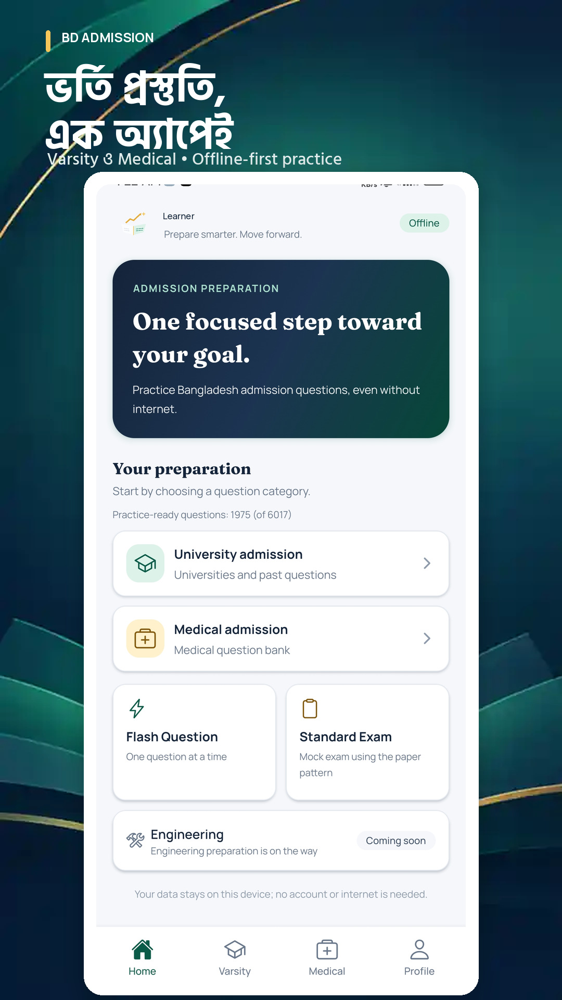
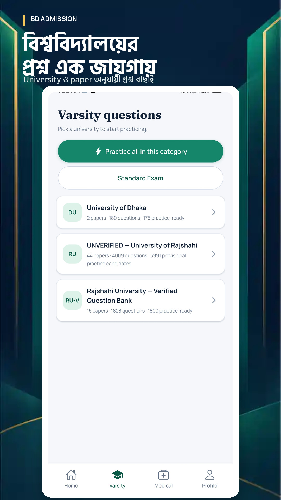
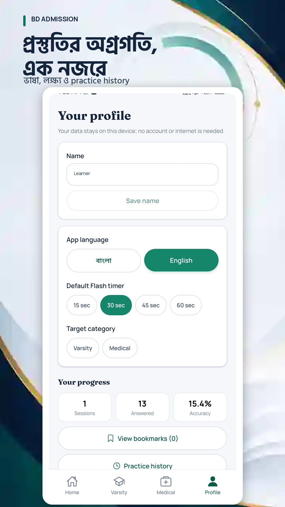

# BD Admission

A Bangladesh-focused, offline-first Android admission-preparation app for university (Varsity) and Medical admission questions. The app supports Bangla and English, question browsing, Flash Question practice, Standard Exam sessions, bookmarks, a local profile, and practice history. Engineering is visible as Coming Soon.

## App preview

  
  
  

Play Store-inspired README artwork built around actual runtime captures; this three-screen set is not a final Play Console asset pack. The profile display name is anonymized, and visible counters are sample local data rather than product-wide usage metrics.

## Current implementation status

The core app implementation is wired across the Expo Router screens, SQLite database lifecycle, repositories, practice services, question-pack importer, and local user data. Automated checks pass as recorded in docs/QA_CHECKLIST.md.

**Android preview released:** BD Admission `0.1.0` is available as the public GitHub pre-release [`v0.1.0-preview.1`](https://github.com/itssourov13/bd-admission-app/releases/tag/v0.1.0-preview.1), published on **31 October 2026 (Bangladesh time)**. Download [`BD.Admission.v0.1.0.apk`](https://github.com/itssourov13/bd-admission-app/releases/download/v0.1.0-preview.1/BD.Admission.v0.1.0.apk). The APK was installed and checked on a physical Android device; the owner reported normal operation. This is an Android preview/pre-release, **not** a Google Play production release.

Two DU A Unit packs are bundled from the supplied scanned question-bank PDFs: 90 questions per session for 2024–2025 and 2025–2026, across six subject sections. The supplied answer-key letters are preserved; three questions without a printed key remain unanswered/unknown rather than guessed. The supplied publisher scan is a question-bank source, not an official DU past-paper notice. The official DU 2025–2026 notice describes 60 marks of MCQ plus 40 marks of written questions, with 45 minutes for each part ([official notice](https://www.du.ac.bd/du_post_details/news/25400)); its complete format differs from the scan’s four-of-six-subject MCQ-only practice pattern. That rule therefore remains **illustrative** and the app labels the selected-paper mode as question-bank practice, not a full official DU exam. Question-level local PNG figures are supported by the runtime. Two items are content-unverified and excluded from scored practice: one figure-only physics item and one mathematics formula whose scanned expression is unclear.

The first EAS preview APK build completed and was published as the GitHub pre-release above. The owner has confirmed physical-device installation and verification. GitHub PR #2 was merged and both the pull-request CI run and the resulting `main` push CI run succeeded. The standard local Hermes bytecode export still raises SIGILL on this ARM/NetHunter host; this host-specific issue did not block the EAS cloud APK build. A production AAB, Play Console listing and production rollout remain outstanding.

## RU question bank sections — separate by source/status

The Varsity catalogue keeps two separate Rajshahi University entries:

- **`RU-V — Rajshahi University — Verified Question Bank`** is the user-confirmed verified source import from `RU Question Bank.pdf`. The previous 15-pack/1,815-question version was replaced by **15 packs / 1,828 questions** covering sessions 2016–2017 through 2024–2025 (units A, C, D1, F and H as represented in the PDF). Every imported question has `contentVerificationStatus: verified` and `answerVerificationStatus: verified`, with four non-empty options. This includes 1,800 single-choice questions, 22 source `X` records retained as `no_correct_option`, and 6 multi-answer records retained as `multiple_choice`. All have subject metadata for Physics, Chemistry, Biology, Higher Mathematics, ICT or English. No imported RU-V question is tagged `unverified` or `unknown`.
- **`RU — UNVERIFIED — University of Rajshahi`** remains the separate 44-pack, 4,009-question RU C Unit candidate bank imported earlier from third-party source pages. Its question/answer statuses, assets and provisional-practice rules were not altered by the RU-V replacement.

The RU Question Bank PDF has 156 pages and SHA-256 `f1fc25faef0bba80d4495002f3006ac4ca1a7ce9da5c26e6a1f7db45218a49c7`. The user confirmed this source/question content as verified; the replacement task repaired extraction structure and imported the source, without repeating question-by-question fact checking. A total of **154** source records remain in the external exclusion ledger: 36 written-part items, 90 with incomplete option count/labels, 26 with missing extracted option text and 2 without an extracted answer marker. The 22 `X` and 6 complete multiple-answer records are included rather than discarded. A white Sutonny text-shadow on page 137 was filtered as a false banner and the printed B answer for Mathematics Q4 was recovered. No answer or option text was fabricated. Thirty included questions with repeated extracted option text are listed in the separate external warning audit. Pack/source/exclusion/reconciliation artifacts are outside the repo under `/home/kali/gpt-workspace/bd-admission-app-data/ruv-work/`.

The bundled catalogue now contains **217 JSON packs / 13,609 questions**: 180 DU A Unit, 4,009 RU C candidates, 1,828 RU-V verified-source questions, 1,526 verified JU questions, 293 verified HSTU questions, 5,011 JU-U candidates and 762 HSTU-U candidates. The original 57 verified JU/HSTU packs are unchanged; the separate follow-up candidate import adds 99 packs / 5,773 questions. Those new banks expose **5,502 structurally safe provisional candidates** (JU-U 4,780; HSTU-U 722), while 42 records with repeated normalized option text are withheld from provisional scoring. All new candidate content and supplied keys remain unverified/unknown exactly as received; all 99 exam rules remain unconfigured. The separate `GST_CLUSTER` archive section (3 packs / 287 questions) was deliberately excluded for a later, dedicated import. The RU C provisional bank and RU-V verified-source bank remain unchanged. The published 2026-10-31 preview APK predates both JU/HSTU additions and does not contain these banks; build and install a new APK to deliver them to devices. The production AAB and Google Play rollout remain pending.

## JU-U + HSTU-U unverified candidate banks — imported 2026-11-01

These are separate catalogue entries, not replacements or additions to the verified `JU` and `HSTU` institutions above:

- **`JU-U — UNVERIFIED — Jahangirnagar University`:** 84 packs / 5,011 questions, with sessions represented from 2010–2011 through 2024–2025. All question content is `unverified`; answer states are 4,820 `unverified` and 191 `unknown`. A provisional pool exposes 4,780 structurally safe candidates; 28 single-key records with repeated normalized option text are browse-only. Twelve questions have exact text-and-ordered-option overlaps with existing packs, and 95 more share a normalized stem but differ in option text/order. They remain separate source records and were not auto-merged.
- **`HSTU-U — UNVERIFIED — Hajee Mohammad Danesh Science and Technology University`:** 15 packs / 762 questions across sessions 2014–2015 through 2024–2025. All question content is `unverified`; answer states are 743 `unverified` and 19 `unknown`. A provisional pool exposes 722 structurally safe candidates; 14 single-key records with repeated normalized option text are browse-only.
- The combined 19 multiple-choice records remain browsable but are not eligible for single-choice practice. No answer was promoted, guessed or rewritten, and all 99 paper rules remain `unconfigured`. Provisional feedback uses unverified source keys and may be wrong; it is not a verified or official score.
- The new banks use separate institution, batch, paper, question and rule identities so the original verified JU/HSTU catalogue entries and their practice pools remain isolated. Source IDs reused across packs or colliding with existing app data were namespaced, with every reference updated.
- The three separate `GST_CLUSTER` packs (287 questions) were **not imported**; GST content will be handled in a dedicated follow-up. HSTU-specific papers remain classified as HSTU even where the source compilation title mentions a GST question bank.
- The current published preview APK predates this addition; a new build/install is required for these candidate banks to appear on a device.

## Jahangirnagar + HSTU verified-source question banks — imported 2026-11-01

- **Jahangirnagar University:** 50 packs / 1,526 questions, covering sessions 2010–2011 through 2024–2025 across 31 represented session/unit combinations. The coverage is a 15-session span, not a claim that every unit/set is complete in every year.
- **Hajee Mohammad Danesh Science and Technology University (HSTU):** 7 packs / 293 questions across 2016–2017, 2017–2018 and 2024–2025 (A/B units and available shifts). This is still a partial historical collection, not the requested 15–20-year HSTU bank.
- Every imported question has `contentVerificationStatus: verified`, matching the Muse AI batch-level verification claim. Per-question answer states remain authoritative and unchanged: JU has 1,414 verified, 111 unverified and 1 unknown; HSTU has 275 verified, 8 unverified and 10 unknown. The combined bank therefore has 1,689 verified, 119 unverified and 11 unknown answer states. No second question-by-question fact-check or answer promotion was performed.
- **1,668 questions** are currently eligible for verified single-choice practice (JU 1,393; HSTU 275). Six JU records retain `multiple_choice` type and 16 retain an explicit `no_correct_option` source marker; neither is forced into the single-choice engine. Six questions have identical option text in at least two choices; those source values were retained as received.
- All 57 JU/HSTU exam-rule records remain `unconfigured`. The app does not infer official marking, duration, question-count or section-selection rules. Browse and Flash practice are available for eligible questions. A general/institution-scoped Standard Exam can still use the app's generic 100-question/60-minute fallback; this is not an official JU/HSTU pattern. No individual JU/HSTU paper has 100 verified-eligible questions, so a paper-specific Standard Exam is not yet available for these packs.
- The source archive was `/home/kali/gpt-workspace/museai/admission-app-research/import-ready/Admission_Import_Ready_Questions_Only.zip` (SHA-256 `cd3f0b449ae9cb18a254197dfe557198e2039ab74d4e0ff64e2abf69cd972f1b`). One source-document ID was shared across 24 JU packs; it was namespaced by batch and all local references updated. Question text, options, answer keys, per-question verification states and source metadata were otherwise preserved. See `docs/QUESTION_IMPORT_WORKFLOW.md` for the full import record.

## Main features

- **Offline-first data:** SQLite is the local source of truth for question content, paper/source references, exam attempts, answers, bookmarks, profile preferences and activity history.
- **Varsity and Medical catalogues:** institution/paper selection is driven by imported data; the question browser paginates results, filters by subject, shows per-subject counts and bookmarks, and orders subject groups canonically.
- **Flash Question:** subject-filterable practice setup, one question at a time, 30-second default with configurable duration, deadline-based timing, no repeats until a pool cycle is exhausted, skip/exit, answer feedback, summaries and persistent history.
- **Standard Exam:** uses the selected paper’s configured question count, duration and subject-selection rule when available; the general all-catalogue mode defaults to 100 questions/60 minutes. For the imported DU A Unit packs, select exactly four of the six subjects, with 15 questions per selected section (60 questions, 45 minutes). The active exam is a single continuously scrollable list, grouped in canonical subject order, with options under every question and a persistent Submit action. Answers stay keyed to question IDs and a serialized write queue drains before finalization; answer clearing, unanswered confirmation, timeout auto-submit, resume, results and review remain supported. Subjects with a missing source answer key are unavailable for scored section selection. The publisher-scan pattern remains illustrative because it differs from the official DU 2025–2026 notice, which also includes a written section; this is not a full official university exam.
- **Separate verified and provisional pools:** RU C, JU-U and HSTU-U each remain clearly labelled as unverified candidate banks and are isolated from any verified entries. Their provisional pools contain 3,991, 4,780 and 722 structurally safe source-key candidates respectively; the new JU/HSTU candidate import withholds 42 repeated-option records from provisional scoring. Practice feedback may be wrong and is never presented as official/verified. The separate RU-V bank contains 1,828 verified-source records: 1,800 single-choice questions are eligible for practice, while 22 source `X`/no-correct-option records and 6 multiple-answer records remain browsable but outside the single-choice engine. No RU/JU/HSTU candidate bank has had official paper-specific rules inferred.
- **Local profile and activity:** Bangla/English preference, preferred Flash duration, progress summary, bookmarks and history persist locally.
- **Engineering:** intentionally presented as Coming Soon.

## Technology

- Expo SDK version ~57.0.31, React Native 0.86.3, TypeScript and Expo Router.
- Expo SQLite with versioned migrations and a serialized SqlDb adapter.
- NativeWind and local shared UI components/theme.
- Bangla and English translations; Bangla is the default language.
- Node's built-in test runner, with SQLite behavior tested via node:sqlite behind the shared database contract.

The project is independent of the original ScholarHub checkout. Reused UI/configuration foundations are copied/adapted into this repository; the app does not require ScholarHub at runtime or build time.

## Setup and development

Use the project's Node version (Node 22.23.1) before running commands:

    source "$HOME/.nvm/nvm.sh"
    nvm use 22.23.1
    pnpm install

Start Expo:

    pnpm start

For the repeatable Expo Go preview setup, tunnel/QR connection, continuous-use, reconnect, and stop steps, see [Expo local preview guide](docs/EXPO_LOCAL_PREVIEW.md). For EAS cloud APK/AAB builds, GitHub CI, device QA and release steps, see [Android build and release guide](docs/ANDROID_RELEASE.md).

**Expo Go SDK match:** this project uses Expo SDK 57. Every Expo Go build supports its own SDK version, so if Expo Go reports “Project is incompatible with this version of Expo Go”, install the matching **SDK 57 Android** build from [expo.dev/go](https://expo.dev/go), then restart Metro. Do not upgrade package versions just to silence the mismatch; an SDK upgrade should be a separate, tested migration. A dedicated development build is the release-oriented alternative.

Run the native Android development flow on a machine with the required Android toolchain and a connected device/emulator:

    pnpm android

## Verification commands

Run the focused automated checks from the project root:

    pnpm test
    pnpm typecheck
    pnpm lint
    pnpm exec expo config --type public
    pnpm doctor

Validate the JavaScript bundle without Hermes bytecode generation:

    pnpm exec expo export --platform android --no-bytecode

The automated checks last verified for the application pass are recorded in docs/QA_CHECKLIST.md. The standard local `pnpm export:android` command still fails when hermesc raises SIGILL on this ARM/NetHunter host. The no-bytecode export validates Metro bundling only; it does not itself generate an APK/AAB. The EAS preview APK was built separately, published in the GitHub pre-release above, and owner-verified on a physical Android device. A production AAB and Google Play release remain outstanding.

## Question data and import

The initial genuine-content packs are:

- `data/question-packs/du-a-2024-2025.json` — 90 DU A Unit questions.
- `data/question-packs/du-a-2025-2026.json` — 90 DU A Unit questions.

Each pack stores the source PDF name/SHA-256, session, six subject sections, source page/question numbers and answer-key verification state. Three questions have no printed correct-answer letter and are intentionally excluded from scored practice. The original PDF scans remain outside the app repository at `/home/kali/gpt-workspace/bd-admission-app-data/`; they are not included in the mobile bundle.

Read:

- docs/QUESTION_DATA_SCHEMA.md for the version-1 pack contract.
- docs/QUESTION_IMPORT_WORKFLOW.md for extraction, verification, validation and import steps.

For a new/updated version-1 JSON pack, validate and regenerate the bundle index:

    pnpm packs:validate data/question-packs/your-pack-file.json
    pnpm packs:index

After rebuilding, startup sync imports changed bundled packs transactionally. Re-imports are idempotent and preserve attempts/bookmarks. Keep answer and marking-rule verification explicit, and keep the original source/page/question-number references.

## Architecture and project documents

- docs/PROJECT_CONTEXT.md — product scope and principles.
- docs/CURRENT_STATE.md — implementation state and limitations.
- docs/ARCHITECTURE.md — runtime, database, route and service design.
- docs/DECISIONS.md — accepted product/technical decisions.
- docs/TASK_STATE.md and docs/HANDOFF.md — completed work and next steps.
- docs/QA_CHECKLIST.md — automated results and checks still requiring a device or real content.
- docs/ANDROID_RELEASE.md — EAS project, Android APK/AAB profiles, GitHub CI and release procedure.
- docs/BRANDING.md — provisional product identity and local assets.
- docs/REUSE_INVENTORY.md — copied/adapted foundations and independence boundaries.

## Product principles

- Core catalog, practice, scoring, history and preferences must work offline.
- Preserve institution, paper/year/unit, source document, page and question-number provenance when supplied.
- Never assume question count, duration, subject distribution or scoring is the same across universities; verify the exact exam pattern from an official source and configure the matching paper/session. Do not fabricate, pad or truncate questions to meet a global count.
- Unknown answers and unverified marking rules must stay unknown.
- Validate and import content transactionally without damaging attempts or bookmarks.
- Do not automatically merge questions based only on similar wording.
- Keep synthetic test fixtures separate from genuine historical question packs.

## RU Unit A research (staged only)

The research folder `/home/kali/gpt-workspace/bd-admission-app-data/ru/` is now scoped to **RU Unit A only**. It contains a source/coverage register for 2010-2011 through the latest completed 2025-2026 session and eight review-only sample packs (21 questions). This is not a complete 15/16-year transcription: the the 2012-2013 to 2023-2024 Drive PDFs remain download-restricted/unreviewed; two 2025-2026 Group 1/2 scans are archived, but not fully transcribed. Read `A_UNIT_YEAR_COVERAGE.csv`, `RESEARCH_REPORT.md`, `SOURCE_REGISTER_A_ONLY.csv` and `REVIEW/ANSWER_AUDIT_A_ONLY.csv`. Nothing is bundled; do not run `pnpm packs:index` until a complete pack has been reviewed and deliberately copied into `data/question-packs/`.

## RU C Unit Science Group — imported for browse/review (2026-10-29)

The external source workspace remains at `/home/kali/gpt-workspace/bd-admission-app-data/ru/science-unit-c/`. The app now bundles 44 RU C Unit Science candidate packs containing **4,009 questions** from sessions 2010–2011 through 2025–2026, alongside the two existing DU A packs. There are 45 local PNG assets resolving all 46 question asset references; `QuestionCard` renders these local figures without adding a dependency.

**These are unverified candidates, not a verified past-paper bank.** Every RU question's content and answer key remains `unverified`; no RU scoring rules were configured. A separate provisional practice path supports 3,991 structurally safe single-choice items when the selected scope has no verified-eligible questions; feedback is based on third-party candidate keys and may be wrong. Eighteen records with duplicate normalized option text are withheld from provisional scoring (the earlier audit recorded 14 exact duplicate-option records). The 158 source records with non-core subject labels and 18 no-option records remain excluded from the imported pack set and preserved externally for review. The imported data does not establish exact official session/group/set provenance.

See `data/question-packs/README.md`, `docs/CURRENT_STATE.md`, `docs/QUESTION_IMPORT_WORKFLOW.md`, and the audit folder `/home/kali/gpt-workspace/bd-admission-app-data/ru/science-unit-c/audit-only/2026-10-29-year-by-year-verification/` for the import and verification boundary.
