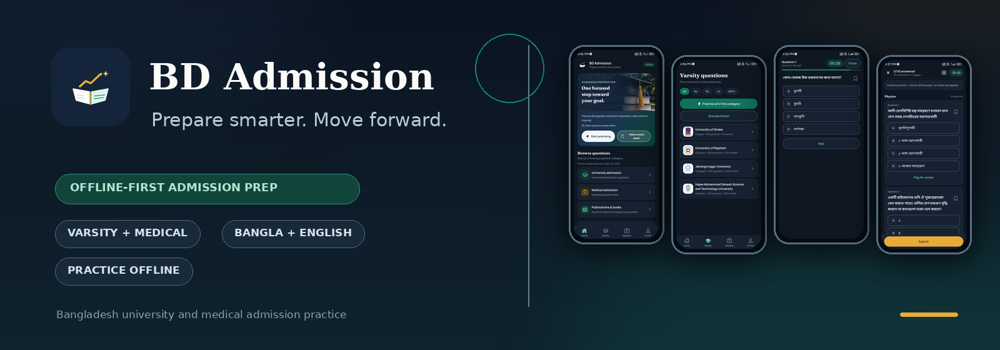
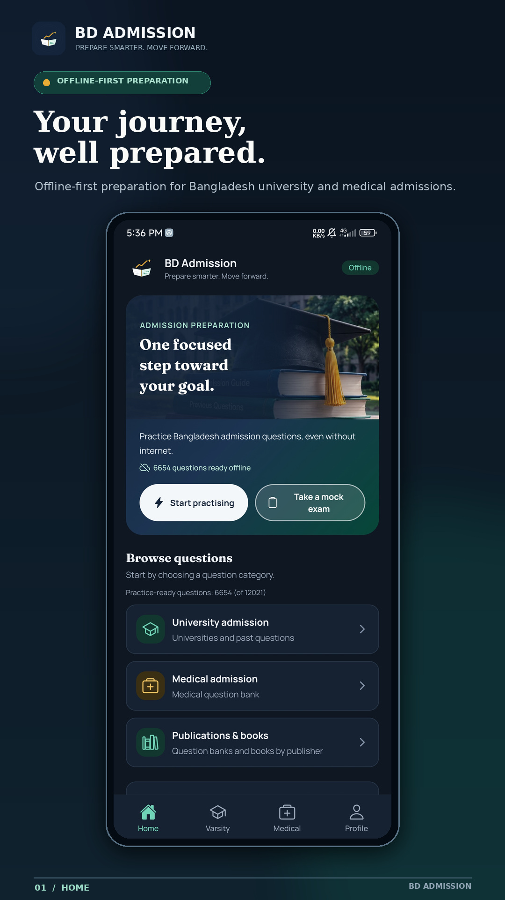
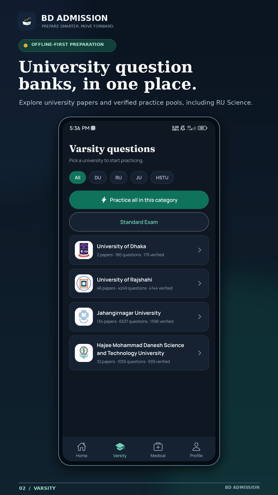
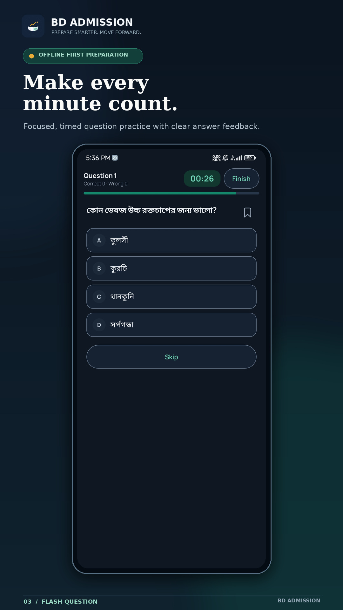
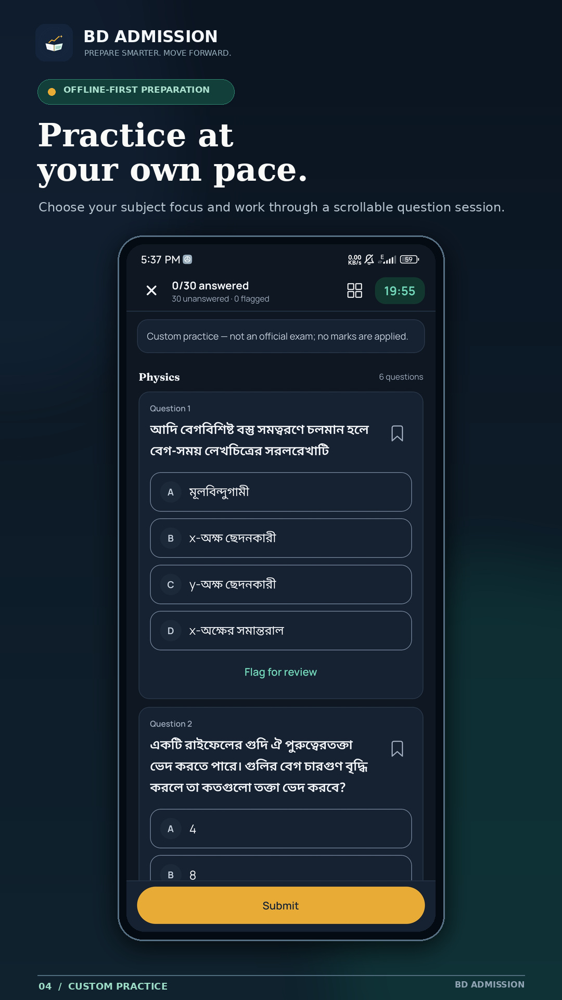

<div align="center">
  
  <p><strong>Offline-first admission preparation for Bangladesh.</strong><br />Practice university and medical admission questions in Bangla or English, with or without an internet connection.</p>
  <p><a href="https://expo.dev/accounts/sk_king13/projects/bd-admission-app/builds/8aa4643c-e312-4a0b-af08-9b3f7779b68c">Android preview APK</a> · <a href="docs/APP_OVERVIEW.md">Product overview</a> · <a href="docs/ANDROID_RELEASE.md">Release details</a></p>
</div>

## App preview

<p align="center">
  
  
  
  
</p>

## Highlights

- **Offline-first:** question banks, practice, bookmarks, profile and history are stored locally.
- **University + Medical:** browse institution-based question banks, papers and subjects.
- **Flexible practice:** Flash Questions, paper-specific exam patterns where configured, and Custom Practice for other scopes.
- **Bilingual experience:** Bangla and English interface with support for mathematical notation and question figures.
- **Question issue reporting:** save content corrections locally, review/edit reports in Profile, and share a privacy-bounded JSON export.

## Current Android preview

**v0.1.12 candidate** · Android versionCode 12 · com.admissionbd.app · EAS preview (internal APK). This release candidate contains CU Bangla catalogue localization, the reordered Profile shortcuts, local question issue reporting (SQLite v13), Profile report management and JSON export through the Android Sharesheet. EAS upload was attempted but had not been accepted when the short monitoring window ended; no v0.1.12 build ID, APK or device test is available yet. The previous v0.1.11 build remains the last completed and owner-tested preview (EAS build 8aa4643c-e312-4a0b-af08-9b3f7779b68c). This is an internal preview candidate, not a Google Play release.

## License

Original application source code and project-authored materials are licensed under [Apache-2.0](LICENSE). Admission question content, institutional marks and other third-party materials retain their own rights; see [NOTICE](NOTICE) and [licensing notes](docs/LICENSING.md).

## Documentation

- [Product overview and content coverage](docs/APP_OVERVIEW.md)
- [Current implementation state](docs/CURRENT_STATE.md) · [Architecture](docs/ARCHITECTURE.md)
- [Question data schema](docs/QUESTION_DATA_SCHEMA.md) · [Import workflow](docs/QUESTION_IMPORT_WORKFLOW.md)
- [Exam-rule research](docs/EXAM_RULE_RESEARCH.md) · [QA checklist](docs/QA_CHECKLIST.md)
- [Android build and release guide](docs/ANDROID_RELEASE.md) · [Development preview guide](docs/EXPO_LOCAL_PREVIEW.md)

## Development

Use Node.js **22.23.1** and pnpm from the project root:

```sh
nvm use 22.23.1
pnpm install
pnpm start
```

Run the automated checks with `pnpm test`, `pnpm typecheck`, and `pnpm lint`. See the [development and verification notes](docs/APP_OVERVIEW.md) before preparing content or a release.
